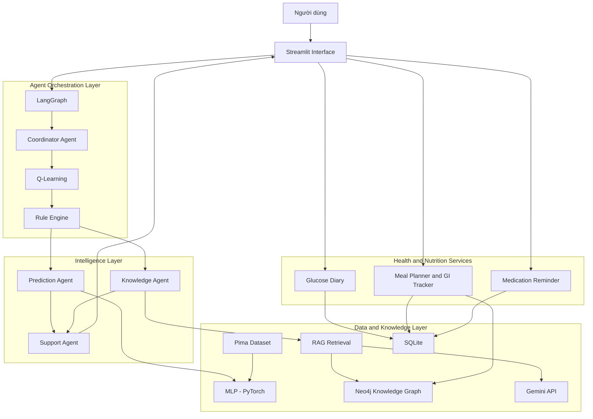
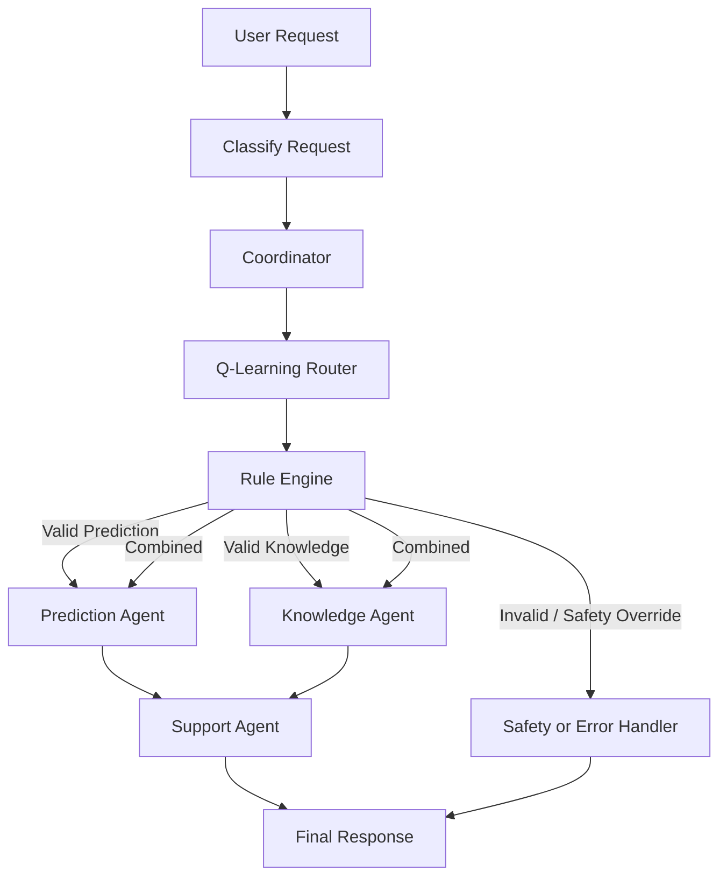

# TÀI LIỆU ĐẶC TẢ TỔNG THỂ DỰ ÁN DIACARE

**Tên đề tài:** Xây dựng hệ đa Agent hỗ trợ đánh giá nguy cơ và tra cứu tri thức bệnh tiểu đường ứng dụng Deep Learning, Neo4j-RAG và Reinforcement Learning.

**Tên tiếng Anh:** Development of a Multi-Agent System for Diabetes Risk Assessment and Medical Knowledge Retrieval Using Deep Learning, Neo4j-RAG, and Reinforcement Learning.

**Tên hệ thống:** DiaCare

**Phiên bản:** 2.0

**Loại hệ thống:** Ứng dụng web hỗ trợ đánh giá nguy cơ sức khỏe, tra cứu tri thức y khoa và hỗ trợ quản lý sức khỏe liên quan đến bệnh tiểu đường.

**Nền tảng:** Python, Streamlit.

**Quy mô thực hiện:** 01 người.

---

# PHẦN I. TỔNG QUAN DỰ ÁN

## 1.1. Bối cảnh

Bệnh tiểu đường là bệnh lý mạn tính cần được theo dõi và quản lý lâu dài. Việc nhận biết các yếu tố nguy cơ, theo dõi chỉ số sức khỏe, duy trì chế độ dinh dưỡng phù hợp và tiếp cận thông tin y khoa đáng tin cậy có vai trò quan trọng trong việc nâng cao nhận thức về bệnh.

Tuy nhiên, người dùng có thể gặp khó khăn khi:

- Theo dõi và đánh giá các chỉ số sức khỏe.
- Nhận biết các yếu tố liên quan đến nguy cơ tiểu đường.
- Tìm kiếm và tổng hợp thông tin y khoa từ nhiều nguồn.
- Theo dõi chỉ số đường huyết theo thời gian.
- Tìm hiểu thành phần dinh dưỡng và lựa chọn thực phẩm phù hợp.
- Ghi nhớ lịch sử dụng thuốc theo hướng dẫn của bác sĩ.

Các hệ thống AI đơn lẻ thường chỉ giải quyết một nhiệm vụ cụ thể. Do đó, DiaCare đề xuất xây dựng một ứng dụng web đa Agent kết hợp Deep Learning, Knowledge Graph, RAG, Reinforcement Learning và Rule Engine, đồng thời cung cấp các công cụ hỗ trợ theo dõi sức khỏe và dinh dưỡng.

## 1.2. Mô tả bài toán

Xây dựng ứng dụng web hỗ trợ người dùng thực hiện các hoạt động:

- Tiếp nhận và xử lý thông tin sức khỏe.
- Dự đoán, phân loại kết quả nguy cơ tiểu đường bằng mô hình Deep Learning.
- Tra cứu kiến thức y khoa thông qua Neo4j kết hợp RAG và Gemini.
- Điều phối các Agent phù hợp bằng Reinforcement Learning.
- Kiểm soát quy trình bằng Rule Engine.
- Ghi nhận và theo dõi chỉ số đường huyết.
- Tra cứu thông tin dinh dưỡng và gợi ý thực đơn.
- Quản lý lịch sử dụng thuốc và nhắc nhở người dùng.
- Tổng hợp kết quả thành thông tin dễ hiểu, có nguồn tham khảo khi cần thiết.

## 1.3. Mục tiêu tổng quát

Xây dựng hệ thống DiaCare có khả năng kết hợp Deep Learning, Knowledge Graph, RAG, Reinforcement Learning và Multi-Agent để hỗ trợ đánh giá nguy cơ tiểu đường, tra cứu tri thức y khoa và quản lý một số thông tin sức khỏe cá nhân.

## 1.4. Mục tiêu cụ thể

1. Xây dựng quy trình tiếp nhận, làm sạch và chuẩn hóa dữ liệu sức khỏe.
2. Huấn luyện mô hình Deep Learning MLP để phân loại nguy cơ tiểu đường.
3. Xây dựng đồ thị tri thức y khoa bằng Neo4j.
4. Phát triển RAG để truy xuất thông tin có nguồn tham khảo.
5. Tích hợp Gemini API để tổng hợp câu trả lời dựa trên ngữ cảnh truy xuất.
6. Xây dựng 04 Agent có nhiệm vụ riêng biệt.
7. Áp dụng Q-Learning để lựa chọn hướng điều phối Agent.
8. Xây dựng Rule Engine nhằm kiểm soát điều kiện xử lý và giới hạn an toàn.
9. Tích hợp các thành phần bằng LangGraph.
10. Xây dựng chức năng nhật ký đường huyết và phân tích xu hướng.
11. Xây dựng chức năng quản lý dinh dưỡng, tra cứu GI và gợi ý thực đơn.
12. Xây dựng chức năng quản lý lịch sử dụng thuốc và nhắc nhở.
13. Xây dựng giao diện Streamlit thống nhất cho người dùng.

---

# PHẦN II. PHẠM VI ĐỀ TÀI

## 2.1. Đối tượng sử dụng

Hệ thống chỉ phục vụ một nhóm người dùng chính: **Người dùng, bệnh nhân hoặc người có nguy cơ mắc bệnh tiểu đường.**

Chức năng:

- Nhập các chỉ số sức khỏe.
- Yêu cầu đánh giá nguy cơ tiểu đường.
- Xem kết quả dự đoán và thông tin giải thích.
- Đặt câu hỏi về bệnh tiểu đường.
- Tra cứu triệu chứng, yếu tố nguy cơ, xét nghiệm và kiến thức liên quan.
- Ghi nhận chỉ số đường huyết.
- Theo dõi lịch sử và biểu đồ đường huyết.
- Tra cứu thực phẩm và thành phần dinh dưỡng.
- Xem thông tin chỉ số đường huyết GI.
- Nhận gợi ý thực đơn tham khảo.
- Quản lý lịch sử dụng thuốc do người dùng nhập theo đơn hoặc hướng dẫn của bác sĩ.
- Nhận nhắc nhở và ghi nhận trạng thái sử dụng thuốc.

Không xây dựng vai trò nhân viên y tế, giao diện quản trị dành riêng cho nhân viên y tế hoặc chức năng giám sát điều phối Agent theo vai trò nhân viên y tế.

## 2.2. Phạm vi chức năng

### A. Xử lý dữ liệu sức khỏe

- Tiếp nhận dữ liệu sức khỏe.
- Kiểm tra dữ liệu thiếu và sai định dạng.
- Phát hiện giá trị không hợp lệ.
- Xử lý giá trị thiếu theo quy trình tiền xử lý.
- Chuẩn hóa đặc trưng.
- Chia dữ liệu thành tập huấn luyện, validation và kiểm thử.
- Đảm bảo dữ liệu đầu vào mới sử dụng cùng quy trình tiền xử lý với dữ liệu huấn luyện.

### B. Đánh giá nguy cơ bằng Deep Learning

- Sử dụng bộ dữ liệu Pima Indians Diabetes.
- Xây dựng mô hình MLP bằng PyTorch.
- Huấn luyện mô hình phân loại nhị phân.
- Dự đoán điểm số đầu ra của mô hình.
- Phân loại theo ngưỡng đã cấu hình và đánh giá.
- Hiển thị kết quả, thông tin đầu vào và giới hạn của mô hình.
- Kết hợp Rule Engine để kiểm tra dữ liệu và cung cấp thông tin an toàn.
- Trình bày kết quả theo dạng báo cáo dễ hiểu.

Kết quả MLP chỉ là kết quả ước lượng của mô hình trên bộ dữ liệu và đặc trưng được hỗ trợ, không phải chẩn đoán hoặc xác suất mắc bệnh đã được hiệu chỉnh lâm sàng.

### C. Trợ lý tri thức y khoa Neo4j-RAG + Gemini

- Xây dựng đồ thị tri thức y khoa.
- Lưu trữ các thực thể và quan hệ liên quan đến bệnh tiểu đường.
- Lưu tài liệu hoặc đoạn tri thức kèm nguồn tham khảo.
- Tạo embedding phục vụ truy xuất ngữ nghĩa.
- Truy xuất tri thức phù hợp với câu hỏi.
- Có khả năng tìm kiếm và cập nhật tài liệu từ các trang y tế đáng tin cậy.
- Kiểm tra nguồn, URL, tổ chức phát hành và thời điểm cập nhật.
- Kết hợp ngữ cảnh truy xuất với Gemini API để tổng hợp câu trả lời.
- Hiển thị nguồn tham khảo cho người dùng.
- Thông báo khi không tìm thấy nguồn phù hợp hoặc dịch vụ bên ngoài không khả dụng.

Các nguồn ưu tiên gồm WHO, ADA, CDC và các tổ chức y tế có uy tín.

Gemini không được phép tự tạo nguồn tham khảo hoặc đưa ra khẳng định y khoa không được hỗ trợ bởi tài liệu truy xuất.

### D. Hệ thống đa Agent

Triển khai 04 Agent:

1. Coordinator Agent.
2. Prediction Agent.
3. Knowledge Agent.
4. Support Agent.

Các chức năng dinh dưỡng, nhật ký đường huyết và nhắc nhở thuốc được tổ chức thành các module nghiệp vụ riêng. Chúng không làm thay đổi số lượng 04 Agent cốt lõi của đề tài.

### E. Reinforcement Learning

- Sử dụng thuật toán Q-Learning.
- Xây dựng trạng thái và hành động điều phối.
- Huấn luyện trên môi trường mô phỏng.
- Lưu Q-table.
- Sử dụng chính sách đã học để đề xuất hành động cho Coordinator Agent.
- Thống kê kết quả lựa chọn hành động và phần thưởng.

Q-Learning chỉ phục vụ điều phối luồng xử lý Agent, không dùng để quyết định chẩn đoán, điều trị, liều thuốc hoặc gợi ý hoạt động thể chất.

### F. Rule Engine

- Kiểm tra tính hợp lệ của dữ liệu.
- Kiểm soát điều kiện gọi Agent.
- Kiểm tra kết quả truy xuất.
- Kiểm soát các trường hợp không đủ dữ liệu.
- Áp dụng các quy tắc an toàn.
- Có quyền ghi đè hành động không phù hợp do Q-Learning đề xuất.
- Kiểm tra các điều kiện cảnh báo được xây dựng từ nguồn y khoa đáng tin cậy.

### G. Nhật ký đường huyết thông minh

- Cho phép người dùng nhập chỉ số đường huyết thủ công.
- Ghi nhận ngày, giờ đo và đơn vị đo.
- Ghi nhận bối cảnh đo như lúc đói, trước ăn, sau ăn hoặc thời điểm khác.
- Lưu lịch sử đo vào cơ sở dữ liệu.
- Hiển thị danh sách lịch sử.
- Biểu diễn dữ liệu bằng biểu đồ theo ngày, tuần và tháng.
- Thống kê giá trị và xu hướng theo thời gian.
- Phát hiện giá trị nằm ngoài ngưỡng tham chiếu hoặc mục tiêu cá nhân đã cấu hình.
- Hiển thị cảnh báo và hướng dẫn tham khảo phù hợp.

Không yêu cầu kết nối trực tiếp với máy đo đường huyết hoặc thiết bị CGM trong phiên bản này.

Cảnh báo không thay thế đánh giá của nhân viên y tế. Hệ thống không tự đưa ra quyết định điều trị dựa trên chỉ số nhập vào.

### H. AI Meal Planner & Glycemic Index Tracker

- Xây dựng danh mục thực phẩm và món ăn.
- Lưu thông tin nguyên liệu và khẩu phần.
- Lưu thông tin thành phần dinh dưỡng như carbohydrate, protein, chất béo và năng lượng khi có dữ liệu đáng tin cậy.
- Lưu chỉ số GI kèm nguồn tham khảo và thông tin về phương pháp hoặc điều kiện đo nếu có.
- Cho phép người dùng tìm kiếm thực phẩm.
- Hiển thị thông tin dinh dưỡng.
- Gợi ý thực đơn tham khảo theo bữa sáng, trưa và tối.
- Hỗ trợ lựa chọn thực đơn theo sở thích và mục tiêu dinh dưỡng do người dùng cung cấp.
- Ghi nhận món ăn đã sử dụng.
- Theo dõi lượng carbohydrate và các thông tin dinh dưỡng có dữ liệu.
- Khai thác Knowledge Graph để liên kết thực phẩm, nguyên liệu, chất dinh dưỡng và thông tin GI.
- Có thể sử dụng Gemini để diễn giải hoặc trình bày gợi ý dựa trên dữ liệu đã truy xuất.

Không coi chỉ số GI là tiêu chí duy nhất để đánh giá một món ăn. Cần xem xét khẩu phần, lượng carbohydrate, thành phần bữa ăn và các yếu tố liên quan.

Không xây dựng thực đơn điều trị cá nhân thay thế tư vấn của chuyên gia dinh dưỡng.

### I. Quản lý thuốc và nhắc nhở

- Cho phép người dùng tự nhập tên thuốc.
- Lưu thông tin lịch sử dụng theo đơn hoặc hướng dẫn của bác sĩ.
- Thiết lập giờ nhắc.
- Hiển thị danh sách lịch nhắc.
- Đánh dấu đã sử dụng, bỏ lỡ hoặc chưa xác nhận.
- Lưu lịch sử thực hiện.
- Thống kê tình trạng tuân thủ lịch nhắc.
- Cho phép chỉnh sửa hoặc ngừng lịch nhắc.

Hệ thống chỉ hỗ trợ ghi nhớ lịch sử dụng thuốc. Không tự kê đơn, đề xuất thuốc, điều chỉnh liều hoặc thay đổi lịch dùng thuốc.

Phiên bản đầu có thể triển khai thông báo trong ứng dụng khi website đang hoạt động. Thông báo khi người dùng đóng trình duyệt cần được xem là phần mở rộng, phụ thuộc vào hạ tầng thông báo và quyền của trình duyệt.

### J. Giao diện

- Xây dựng ứng dụng Streamlit.
- Chỉ có một chế độ người dùng.
- Hiển thị tổng quan.
- Hiển thị trang đánh giá nguy cơ.
- Hiển thị trang tra cứu tri thức y khoa.
- Hiển thị nhật ký đường huyết.
- Hiển thị quản lý dinh dưỡng và thực đơn.
- Hiển thị quản lý thuốc và nhắc nhở.
- Hiển thị trạng thái xử lý, loading và lỗi.
- Hiển thị nguồn tham khảo và cảnh báo an toàn.

## 2.3. Ngoài phạm vi

Các nội dung sau không thuộc phạm vi phiên bản hiện tại:

- Không thay thế bác sĩ trong chẩn đoán hoặc điều trị.
- Không kê đơn hoặc điều chỉnh liều thuốc.
- Không xây dựng vai trò nhân viên y tế hoặc hệ thống quản lý bệnh viện.
- Không kết nối trực tiếp với thiết bị đo đường huyết, CGM hoặc thiết bị đeo.
- Không tích hợp hồ sơ bệnh án điện tử.
- Không triển khai hệ thống quy mô bệnh viện.
- Không cam kết độ chính xác lâm sàng.
- Không xây dựng ứng dụng di động riêng.
- Không triển khai hệ thống phân tán hoặc nhiều máy chủ.
- Không xây dựng kế hoạch vận động bằng Q-Learning.
- Không sử dụng Q-Learning để đưa ra quyết định điều trị.
- Không tự động điều chỉnh insulin hoặc thuốc.
- Không đảm bảo gửi thông báo khi website đóng nếu chưa triển khai hạ tầng thông báo nền.
- Không huấn luyện mô hình từ dữ liệu bệnh nhân thực tế nếu chưa có quyền sử dụng và quy trình bảo vệ dữ liệu phù hợp.

## 2.4. Giới hạn của hệ thống

- Bộ dữ liệu Pima có quy mô và đặc điểm đối tượng riêng, không đại diện cho toàn bộ dân số Việt Nam.
- Mô hình chỉ đánh giá theo các đặc trưng có trong bộ dữ liệu.
- Pima có 8 đặc trưng đầu vào, không bao gồm HbA1c.
- Kết quả dự đoán phụ thuộc vào chất lượng dữ liệu và mô hình.
- Tri thức RAG phụ thuộc vào chất lượng, độ cập nhật và khả năng truy xuất của nguồn tài liệu.
- Gemini có thể tạo thông tin không chính xác nếu không được kiểm soát bằng ngữ cảnh và nguồn.
- Chỉ số GI có thể thay đổi theo giống thực phẩm, cách chế biến và điều kiện đo.
- Dữ liệu dinh dưỡng và thực đơn chỉ đáng tin cậy trong phạm vi nguồn đã kiểm chứng.
- Nhật ký đường huyết phụ thuộc vào dữ liệu người dùng tự nhập.
- Nhắc nhở thuốc phụ thuộc vào lịch do người dùng cung cấp.
- Q-Learning được huấn luyện trong môi trường mô phỏng, không học quyết định điều trị từ bệnh nhân thực tế.

---

# PHẦN III. CÔNG NGHỆ SỬ DỤNG

## 3.1. Bảng công nghệ

| Thành phần | Công nghệ | Vai trò |
|---|---|---|
| Ngôn ngữ | Python | Ngôn ngữ phát triển chính |
| Giao diện | Streamlit | Xây dựng ứng dụng web |
| Xử lý dữ liệu | Pandas, NumPy | Đọc, xử lý và phân tích dữ liệu |
| Tiền xử lý | Scikit-learn | Imputation, scaling và đánh giá |
| Deep Learning | PyTorch | Xây dựng và huấn luyện MLP |
| Cơ sở dữ liệu đồ thị | Neo4j | Lưu trữ Knowledge Graph |
| Truy xuất tri thức | RAG | Tìm kiếm tài liệu và tri thức liên quan |
| Embedding | Sentence Transformers hoặc embedding API | Chuyển văn bản thành vector |
| LLM | Gemini API | Tổng hợp câu trả lời dựa trên ngữ cảnh |
| Multi-Agent | LangGraph | Quản lý workflow và trạng thái Agent |
| Reinforcement Learning | Q-Learning bằng NumPy | Học lựa chọn hành động điều phối |
| Rule Engine | Python | Kiểm tra và kiểm soát quy tắc |
| Cơ sở dữ liệu nghiệp vụ | SQLite | Lưu nhật ký đường huyết, thực đơn và lịch nhắc thuốc trong MVP |
| Trực quan hóa | Matplotlib hoặc thư viện hiện có | Hiển thị biểu đồ sức khỏe |
| Nhắc nhở | Python Scheduler hoặc cơ chế kiểm tra lịch trong ứng dụng | Quản lý thời điểm nhắc |
| Kiểm thử | Pytest | Kiểm thử các module |
| Quản lý biến môi trường | python-dotenv | Quản lý cấu hình |
| Quản lý mã nguồn | Git | Theo dõi và lưu phiên bản |

Việc bổ sung SQLite cần được tích hợp theo cách không làm ảnh hưởng đến Neo4j đang sử dụng cho Knowledge Graph. Hai hệ thống dữ liệu có nhiệm vụ khác nhau.

## 3.2. Vai trò các công nghệ

**Python:** Ngôn ngữ chính phát triển các module nghiệp vụ, Agent, xử lý dữ liệu và AI.

**Streamlit:** Xây dựng giao diện web, tiếp nhận thông tin và hiển thị kết quả.

**PyTorch:** Xây dựng, huấn luyện và chạy dự đoán MLP.

**Neo4j:** Lưu trữ các quan hệ tri thức y khoa và dữ liệu liên quan đến dinh dưỡng.

**RAG:** Truy xuất ngữ cảnh phù hợp trước khi gửi yêu cầu đến LLM.

**Gemini API:** Tổng hợp và diễn giải nội dung từ ngữ cảnh đã truy xuất.

**LangGraph:** Quản lý trạng thái, thứ tự thực thi và điều kiện chuyển tiếp giữa các Agent.

**Q-Learning:** Đề xuất hành động điều phối Agent dựa trên trạng thái yêu cầu.

**Rule Engine:** Kiểm soát dữ liệu, hành động điều phối và các điều kiện an toàn.

**SQLite:** Lưu trữ dữ liệu nghiệp vụ do người dùng nhập và lịch sử sử dụng.

**Scheduler:** Kiểm tra lịch nhắc và kích hoạt thông báo trong phạm vi ứng dụng hỗ trợ.

---

# PHẦN IV. KIẾN TRÚC TỔNG THỂ

## 4.1. Mô hình kiến trúc

Hệ thống được tổ chức thành các lớp:

1. Presentation Layer.
2. Agent Orchestration Layer.
3. Intelligence Layer.
4. Health and Nutrition Services Layer.
5. Data and Knowledge Layer.

**Presentation Layer:** Streamlit tiếp nhận tương tác và hiển thị kết quả.

**Agent Orchestration Layer:** Coordinator Agent, LangGraph, Q-Learning và Rule Engine.

**Intelligence Layer:** Prediction Agent, Knowledge Agent và Support Agent.

**Health and Nutrition Services Layer:** Nhật ký đường huyết, dinh dưỡng, thực đơn và quản lý thuốc.

**Data and Knowledge Layer:** Pima Dataset, mô hình MLP, Neo4j, SQLite và tài liệu y khoa.

## 4.2. Sơ đồ kiến trúc tổng thể



## 4.3. Nguyên tắc hoạt động

- Streamlit đảm nhiệm giao diện và gọi các service hoặc workflow.
- Coordinator Agent chịu trách nhiệm điều phối các yêu cầu thuộc luồng Multi-Agent.
- Q-Learning đề xuất hành động.
- Rule Engine kiểm tra hành động trước khi thực thi.
- Prediction Agent gọi mô hình MLP.
- Knowledge Agent gọi Neo4j, RAG và Gemini.
- Support Agent tổng hợp kết quả của các Agent.
- Các module nhật ký, dinh dưỡng và nhắc thuốc được tách biệt với logic dự đoán.
- Không để giao diện tự thực hiện truy vấn AI hoặc xử lý nghiệp vụ phức tạp thay cho các module tương ứng.

---

# PHẦN V. THIẾT KẾ HỆ THỐNG MULTI-AGENT

## 5.1. Danh sách Agent

| Agent | Nhiệm vụ | Đầu vào | Đầu ra |
|---|---|---|---|
| Coordinator Agent | Phân tích yêu cầu và điều phối | User request | Intent, action, workflow state |
| Prediction Agent | Dự đoán nguy cơ | Health data | Model score, predicted class |
| Knowledge Agent | Truy xuất tri thức y khoa | Medical question | Answer, context, sources |
| Support Agent | Tổng hợp kết quả | Prediction và Knowledge result | Final response |

Các module đường huyết, dinh dưỡng và thuốc là các dịch vụ nghiệp vụ độc lập, không làm tăng số lượng Agent cốt lõi.

## 5.2. Coordinator Agent

Nhiệm vụ:

- Tiếp nhận yêu cầu.
- Phân loại ý định.
- Xác định Agent cần thực hiện.
- Gọi Q-Learning để đề xuất hành động.
- Gọi Rule Engine kiểm tra hành động.
- Điều phối Agent.
- Thu thập kết quả.
- Chuyển kết quả đến Support Agent.

Các intent:

| Intent | Mô tả |
|---|---|
| risk_assessment | Đánh giá nguy cơ |
| medical_question | Tra cứu kiến thức y khoa |
| combined_request | Đánh giá và tra cứu kết hợp |
| general_support | Hỗ trợ chung |

Các thao tác nhật ký, dinh dưỡng và thuốc được xử lý bởi module nghiệp vụ tương ứng, không bắt buộc phải đi qua Q-Learning.

## 5.3. Prediction Agent

- Nhận dữ liệu sức khỏe.
- Kiểm tra dữ liệu.
- Gọi mô hình MLP.
- Nhận điểm số mô hình.
- Trả về kết quả phân loại.
- Giải thích giới hạn của mô hình.

Prediction Agent không được tự tạo kết quả dự đoán hoặc thay thế mô hình bằng câu trả lời LLM.

## 5.4. Knowledge Agent

- Tiếp nhận câu hỏi y khoa.
- Truy xuất thông tin từ Neo4j.
- Truy xuất các đoạn tài liệu liên quan.
- Tổng hợp ngữ cảnh.
- Gửi ngữ cảnh đến Gemini.
- Kiểm tra kết quả và nguồn.
- Trả về câu trả lời cùng nguồn tham khảo.

Nếu không có nguồn phù hợp, Agent phải thông báo không đủ dữ liệu.

## 5.5. Support Agent

- Nhận kết quả từ Prediction Agent và Knowledge Agent.
- Tổng hợp nội dung bằng ngôn ngữ dễ hiểu.
- Phân biệt kết quả mô hình với thông tin y khoa.
- Giữ nguyên nguồn tham khảo.
- Trình bày cảnh báo an toàn khi cần.
- Không đưa ra phác đồ điều trị hoặc kê đơn.

## 5.6. Luồng phối hợp Agent

**Trường hợp 1: Đánh giá nguy cơ**

```text
User
  |
  v
Coordinator Agent
  |
  v
Q-Learning
  |
  v
Rule Engine
  |
  v
Prediction Agent
  |
  v
MLP Model
  |
  v
Support Agent
  |
  v
Streamlit Result
```

**Trường hợp 2: Tra cứu tri thức**

```text
User
  |
  v
Coordinator Agent
  |
  v
Q-Learning
  |
  v
Rule Engine
  |
  v
Knowledge Agent
  |
  v
Neo4j + RAG
  |
  v
Gemini API
  |
  v
Support Agent
  |
  v
Streamlit Result
```

**Trường hợp 3: Yêu cầu kết hợp**

Coordinator điều phối Prediction Agent và Knowledge Agent. Hai kết quả được chuyển đến Support Agent để tổng hợp.

---

# PHẦN VI. THIẾT KẾ DEEP LEARNING

## 6.1. Bộ dữ liệu

Sử dụng Pima Indians Diabetes Dataset.

Bộ dữ liệu gồm 768 mẫu và 9 cột:

- Pregnancies.
- Glucose.
- BloodPressure.
- SkinThickness.
- Insulin.
- BMI.
- DiabetesPedigreeFunction.
- Age.
- Outcome.

Trong đó:

- 8 cột đầu là đặc trưng đầu vào.
- Outcome là nhãn mục tiêu nhị phân.

## 6.2. Quy trình xử lý dữ liệu

```text
Raw Dataset
    |
    v
Data Inspection
    |
    v
Missing / Invalid Value Handling
    |
    v
Train / Validation / Test Split
    |
    v
Imputation
    |
    v
Feature Scaling
    |
    v
Processed Dataset
```

Nguyên tắc:

- Kiểm tra dữ liệu trước khi xử lý.
- Xử lý giá trị 0 bất hợp lý ở một số đặc trưng sinh học theo quy trình đã xác định.
- Không thay đổi các giá trị 0 có ý nghĩa hợp lệ.
- Chia tập dữ liệu có stratification.
- Chỉ fit imputer và scaler trên tập train.
- Áp dụng cùng bộ tiền xử lý cho validation, test và dữ liệu mới.

## 6.3. Kiến trúc MLP

```text
Input Layer: 8 features
       |
       v
Hidden Layer 1
       |
     ReLU
       |
    Dropout
       |
       v
Hidden Layer 2
       |
     ReLU
       |
    Dropout
       |
       v
Output Layer: 1
       |
       v
Sigmoid Probability
       |
       v
Binary Classification
```

Cấu hình ban đầu:

- Optimizer: Adam.
- Loss: BCEWithLogitsLoss.
- Activation: ReLU.
- Regularization: Dropout.
- Early Stopping dựa trên validation.
- Lưu checkpoint tốt nhất.

Các siêu tham số cần được lựa chọn qua thực nghiệm.

## 6.4. Đánh giá mô hình

Các chỉ số:

- Accuracy.
- Precision.
- Recall.
- F1-score.
- ROC-AUC.
- Confusion Matrix.

Không chỉ sử dụng Accuracy vì dữ liệu có thể mất cân bằng giữa hai lớp.

Kết quả phải được lưu trong báo cáo thực nghiệm và lấy từ lần đánh giá thực tế.

## 6.5. Đầu ra Prediction Agent

```json
{
  "predicted_class": 1,
  "model_score": 0.72,
  "risk_label": "High model-estimated risk",
  "model_version": "mlp_v1",
  "disclaimer": "Educational risk estimation, not a diagnosis"
}
```

Các con số trên chỉ minh họa cấu trúc, không phải kết quả thực tế.

Điểm số mô hình không mặc nhiên là xác suất mắc bệnh đã được hiệu chỉnh lâm sàng.

## 6.6. Giao diện đánh giá nguy cơ

Sau khi người dùng nhập dữ liệu, hệ thống hiển thị:

- Kết quả phân loại của MLP.
- Điểm số đầu ra của mô hình.
- Ngưỡng phân loại được sử dụng.
- Các dữ liệu đầu vào.
- Những giới hạn của mô hình.
- Các yếu tố cần được người dùng trao đổi thêm với nhân viên y tế.
- Khuyến nghị tìm kiếm tư vấn y tế khi phù hợp.

Không mô phỏng vai trò bác sĩ hoặc khẳng định người dùng mắc bệnh dựa trên kết quả mô hình.

---

# PHẦN VII. THIẾT KẾ NEO4J + RAG + GEMINI

## 7.1. Mục tiêu

Xây dựng hệ thống lưu trữ và truy xuất tri thức y khoa liên quan đến bệnh tiểu đường, đồng thời sử dụng Gemini để tổng hợp câu trả lời dựa trên nội dung đã truy xuất.

## 7.2. Thiết kế Knowledge Graph y khoa

Các loại node:

| Node | Thuộc tính |
|---|---|
| Disease | id, name, description |
| Symptom | id, name, description |
| RiskFactor | id, name, description |
| MedicalTest | id, name, description |
| Guideline | id, title, content |
| MedicalSource | id, name, url, published_date |
| KnowledgeChunk | id, content, embedding |

Các quan hệ:

| Relationship | Ý nghĩa |
|---|---|
| HAS_SYMPTOM | Bệnh có triệu chứng |
| HAS_RISK_FACTOR | Bệnh liên quan yếu tố nguy cơ |
| RELATED_TEST | Bệnh liên quan xét nghiệm |
| HAS_GUIDANCE | Bệnh có hướng dẫn |
| CITED_FROM | Đoạn tri thức được trích từ nguồn |
| SUPPORTED_BY | Thông tin được hỗ trợ bởi nguồn |

## 7.3. Nguồn tri thức

Ưu tiên:

- World Health Organization (WHO).
- American Diabetes Association (ADA).
- Centers for Disease Control and Prevention (CDC).
- Các tổ chức y tế và tài liệu y khoa chính thống.

Mỗi tài liệu cần lưu:

- Tên tài liệu.
- Tổ chức phát hành.
- URL.
- Ngày xuất bản hoặc cập nhật nếu có.
- Nội dung trích xuất.
- Ngày đưa vào hệ thống.

## 7.4. Quy trình cập nhật tài liệu

```text
Trusted Medical Websites
        |
        v
Document Retrieval
        |
        v
Content Extraction
        |
        v
Source Validation
        |
        v
Chunking and Embedding
        |
        v
Neo4j Knowledge Graph
```

Việc thu thập dữ liệu phải tuân thủ điều khoản sử dụng của nguồn, không thu thập tùy tiện hoặc bỏ qua thông tin bản quyền.

## 7.5. Quy trình RAG

```text
User Question
      |
      v
Question Processing
      |
      v
Embedding Generation
      |
      v
Vector Retrieval / Graph Retrieval
      |
      v
Relevant Context
      |
      v
Gemini API
      |
      v
Answer Validation
      |
      v
Answer + Sources
```

Gemini chỉ tổng hợp dựa trên ngữ cảnh được cung cấp. Hệ thống phải giữ nguồn tham khảo và không cho phép mô hình tự bịa URL hoặc tổ chức phát hành.

## 7.6. Định dạng kết quả Knowledge Agent

```json
{
  "question": "HbA1c là gì?",
  "answer": "Nội dung trả lời dựa trên tài liệu được truy xuất.",
  "retrieved_context": [],
  "sources": [
    {
      "title": "Tên tài liệu",
      "organization": "Tổ chức phát hành",
      "url": "URL nguồn"
    }
  ],
  "retrieval_status": "success"
}
```

---

# PHẦN VIII. THIẾT KẾ REINFORCEMENT LEARNING

## 8.1. Mục tiêu

Sử dụng Q-Learning để lựa chọn hành động điều phối Agent dựa trên loại yêu cầu của người dùng.

Q-Learning hoạt động trong môi trường mô phỏng, hỗ trợ lựa chọn tuyến xử lý kỹ thuật. Không sử dụng Q-Learning để đưa ra quyết định chẩn đoán hoặc điều trị.

## 8.2. State Space

| State | Điều kiện |
|---|---|
| S1 | Có dữ liệu sức khỏe |
| S2 | Có câu hỏi y khoa |
| S3 | Có cả dữ liệu sức khỏe và câu hỏi y khoa |

## 8.3. Action Space

| Action | Ý nghĩa |
|---|---|
| A1 | Gọi Prediction Agent |
| A2 | Gọi Knowledge Agent |
| A3 | Gọi cả Prediction và Knowledge Agent |

## 8.4. Reward Design

| State | A1 | A2 | A3 |
|---|---:|---:|---:|
| S1 | +10 | -5 | -2 |
| S2 | -5 | +10 | -2 |
| S3 | -5 | -5 | +10 |

Đây là phần thưởng mô phỏng ban đầu. Có thể bổ sung hình phạt cho chi phí gọi Agent không cần thiết.

## 8.5. Q-Learning

Công thức cập nhật:

Q(s,a) = Q(s,a) + α[r + γ max Q(s',a') - Q(s,a)]

Các tham số:

- Learning rate.
- Discount factor.
- Epsilon.
- Epsilon decay.
- Number of episodes.

## 8.6. Đầu ra

- Q-table.
- Số episode huấn luyện.
- Tổng reward.
- Số lần chọn mỗi action.
- Biểu đồ reward theo episode.
- Hàm choose_action(state).

Q-table được lưu để sử dụng trong Coordinator Agent.

---

# PHẦN IX. THIẾT KẾ RULE ENGINE

## 9.1. Mục tiêu

Rule Engine kiểm soát tính hợp lệ và an toàn của quy trình xử lý.

## 9.2. Các nhóm luật

| Rule ID | Điều kiện | Hành động |
|---|---|---|
| R01 | Dữ liệu thiếu trường bắt buộc | Yêu cầu bổ sung |
| R02 | Dữ liệu sai kiểu hoặc không hợp lệ | Từ chối xử lý |
| R03 | Intent là risk_assessment | Cho phép Prediction Agent khi dữ liệu hợp lệ |
| R04 | Intent là medical_question | Cho phép Knowledge Agent |
| R05 | Intent là combined_request | Cho phép cả hai Agent |
| R06 | Phát hiện dấu hiệu cần đánh giá y tế khẩn cấp theo quy tắc đã xác minh | Ưu tiên thông báo an toàn |
| R07 | RAG không có nguồn phù hợp | Không đưa ra câu trả lời y khoa khẳng định |
| R08 | Chỉ số đường huyết nằm ngoài ngưỡng tham chiếu được cấu hình | Hiển thị cảnh báo phù hợp |
| R09 | Dữ liệu thực phẩm thiếu nguồn đáng tin cậy | Không khẳng định chỉ số dinh dưỡng hoặc GI |
| R10 | Lịch thuốc không hợp lệ | Yêu cầu người dùng kiểm tra và chỉnh sửa |

## 9.3. Nguyên tắc ưu tiên

1. Kiểm tra điều kiện an toàn.
2. Kiểm tra tính hợp lệ của dữ liệu.
3. Kiểm tra intent.
4. Kiểm tra hành động Q-Learning đề xuất.
5. Cho phép, điều chỉnh hoặc từ chối hành động.
6. Ghi log kết quả kiểm tra.

Rule Engine có quyền ghi đè lựa chọn của Q-Learning.

Không sử dụng ngưỡng tự đặt để kết luận bệnh hoặc tạo cảnh báo y khoa thiếu căn cứ.

---

# PHẦN X. THIẾT KẾ LANGGRAPH

## 10.1. Mục tiêu

LangGraph quản lý luồng thực thi và trạng thái chung của hệ thống Multi-Agent.

## 10.2. Các node

| Node | Chức năng |
|---|---|
| classify_request | Phân loại yêu cầu |
| coordinator | Xác định luồng xử lý |
| q_learning_router | Đề xuất hành động |
| rule_check | Kiểm tra luật |
| prediction_node | Gọi Prediction Agent |
| knowledge_node | Gọi Knowledge Agent |
| support_node | Gọi Support Agent |
| error_handler | Xử lý lỗi |
| end | Trả kết quả |

## 10.3. State dùng chung

```python
{
    "user_input": {},
    "intent": "",
    "health_data": {},
    "medical_question": "",
    "selected_action": "",
    "rule_result": {},
    "prediction_result": {},
    "knowledge_result": {},
    "support_result": {},
    "execution_logs": [],
    "error": None
}
```

State cần được kiểm tra kiểu dữ liệu và cập nhật có kiểm soát.

## 10.4. Luồng thực thi



Luồng phải có nhánh kết thúc, nhánh lỗi và giới hạn số lần thực thi để tránh vòng lặp vô hạn.

Các module nhật ký, dinh dưỡng và nhắc thuốc có thể được gọi thông qua các service nghiệp vụ riêng, không bắt buộc đi qua workflow Q-Learning.

---

# PHẦN XI. THIẾT KẾ NHẬT KÝ ĐƯỜNG HUYẾT THÔNG MINH

## 11.1. Mục tiêu

Cung cấp chức năng ghi nhận và theo dõi chỉ số đường huyết theo thời gian, giúp người dùng quan sát dữ liệu cá nhân.

## 11.2. Thông tin ghi nhận

| Trường | Mô tả |
|---|---|
| id | Mã bản ghi |
| glucose_value | Giá trị đường huyết |
| unit | Đơn vị đo |
| measured_at | Thời điểm đo |
| measurement_context | Bối cảnh đo |
| note | Ghi chú |
| created_at | Thời điểm tạo bản ghi |

Các bối cảnh đo có thể gồm:

- Lúc đói.
- Trước ăn.
- Sau ăn.
- Trước khi ngủ.
- Thời điểm khác.

Đơn vị và bối cảnh đo phải được lưu rõ ràng để tránh so sánh các giá trị không tương đương.

## 11.3. Chức năng

- Thêm bản ghi.
- Chỉnh sửa bản ghi.
- Xóa bản ghi.
- Xem lịch sử.
- Lọc theo khoảng thời gian.
- Hiển thị biểu đồ.
- Thống kê dữ liệu.
- Phát hiện xu hướng.
- Hiển thị cảnh báo theo ngưỡng tham chiếu hoặc mục tiêu cá nhân được cấu hình.

## 11.4. Quy trình xử lý

```text
User Input
    |
    v
Input Validation
    |
    v
Rule Engine
    |
    v
Save to SQLite
    |
    v
Calculate Statistics
    |
    v
Generate Chart
    |
    v
Display Trends and Alerts
```

## 11.5. Nguyên tắc an toàn

- Không kết luận bệnh từ một lần đo.
- Không tự đề xuất thay đổi liều thuốc.
- Không coi biểu đồ là chẩn đoán.
- Cảnh báo phải phân biệt rõ bối cảnh đo, đơn vị và mục tiêu cá nhân.
- Không dùng một ngưỡng chung cho mọi người nếu chưa xác định được bối cảnh phù hợp.

---

# PHẦN XII. THIẾT KẾ AI MEAL PLANNER & GLYCEMIC INDEX TRACKER

## 12.1. Mục tiêu

Xây dựng chức năng hỗ trợ người dùng tìm hiểu thực phẩm, thành phần dinh dưỡng, chỉ số GI và tham khảo thực đơn thông qua dữ liệu có nguồn.

## 12.2. Knowledge Graph dinh dưỡng

Các loại node:

| Node | Thuộc tính |
|---|---|
| Food | id, name, category |
| Ingredient | id, name |
| Nutrient | id, name, unit |
| GlycemicIndex | id, value, source |
| Meal | id, name, meal_type |
| DietaryGoal | id, name |
| NutritionSource | id, name, url |

Các quan hệ:

| Relationship | Ý nghĩa |
|---|---|
| CONTAINS | Món ăn chứa nguyên liệu |
| HAS_NUTRIENT | Thực phẩm có chất dinh dưỡng |
| HAS_GI | Thực phẩm có thông tin GI |
| PART_OF_MEAL | Món ăn thuộc thực đơn |
| SUPPORTED_BY | Dữ liệu được hỗ trợ bởi nguồn |
| SUITABLE_FOR | Liên quan đến mục tiêu dinh dưỡng |

Quan hệ SUITABLE_FOR chỉ được thiết lập khi có căn cứ và không được hiểu là khẳng định thực phẩm phù hợp với mọi bệnh nhân.

## 12.3. Dữ liệu dinh dưỡng

Thông tin cần lưu:

- Tên thực phẩm.
- Nhóm thực phẩm.
- Thành phần nguyên liệu.
- Khẩu phần tham chiếu.
- Năng lượng.
- Carbohydrate.
- Protein.
- Chất béo.
- Chất xơ nếu có.
- Chỉ số GI nếu có nguồn đáng tin cậy.
- Nguồn dữ liệu.
- Ngày cập nhật.

Không tự tạo chỉ số GI hoặc thành phần dinh dưỡng khi không có nguồn.

## 12.4. Chức năng

- Tìm kiếm thực phẩm.
- Xem chi tiết dinh dưỡng.
- Xem thông tin GI và nguồn.
- Lọc thực phẩm theo nhóm.
- Tạo thực đơn tham khảo.
- Hiển thị thực đơn sáng, trưa và tối.
- Điều chỉnh lựa chọn thực phẩm.
- Theo dõi thực phẩm đã sử dụng.
- Thống kê carbohydrate và năng lượng khi có đủ dữ liệu.

## 12.5. Quy trình gợi ý thực đơn

```text
User Preferences
       |
       v
Food and Nutrition Query
       |
       v
Neo4j Knowledge Graph
       |
       v
Retrieve Food and Nutrient Data
       |
       v
Meal Planning Rules
       |
       v
Optional Gemini Explanation
       |
       v
Meal Plan + Sources
```

## 12.6. Nguyên tắc an toàn

- Không dùng GI làm tiêu chí duy nhất.
- Xem xét khẩu phần và lượng carbohydrate.
- Không gắn nhãn thực phẩm là an toàn tuyệt đối.
- Không tạo chế độ ăn điều trị thay thế chuyên gia dinh dưỡng.
- Các gợi ý cần có ghi chú về giới hạn dữ liệu và nguồn.

---

# PHẦN XIII. THIẾT KẾ QUẢN LÝ THUỐC VÀ NHẮC NHỞ

## 13.1. Mục tiêu

Hỗ trợ người dùng ghi nhận lịch sử dụng thuốc theo đơn hoặc hướng dẫn đã được bác sĩ cung cấp và nhắc nhở theo thời gian đã thiết lập.

## 13.2. Dữ liệu thuốc

| Trường | Mô tả |
|---|---|
| id | Mã thuốc |
| medicine_name | Tên thuốc |
| dosage_note | Thông tin liều do người dùng nhập theo đơn |
| schedule | Lịch sử dụng |
| start_date | Ngày bắt đầu |
| end_date | Ngày kết thúc nếu có |
| note | Ghi chú |
| is_active | Trạng thái lịch |

## 13.3. Dữ liệu lịch sử nhắc

| Trường | Mô tả |
|---|---|
| id | Mã lịch sử |
| medicine_id | Mã thuốc |
| scheduled_at | Thời điểm dự kiến |
| status | Pending, Taken, Missed |
| confirmed_at | Thời điểm xác nhận |

## 13.4. Chức năng

- Thêm lịch thuốc.
- Chỉnh sửa lịch.
- Xóa hoặc ngừng lịch.
- Xem lịch trong ngày.
- Nhắc theo thời gian.
- Đánh dấu đã sử dụng.
- Đánh dấu bỏ lỡ.
- Xem lịch sử.
- Thống kê tình trạng thực hiện.

## 13.5. Quy trình

```text
User Creates Medication Schedule
             |
             v
        Input Validation
             |
             v
          Save SQLite
             |
             v
       Check Reminder Time
             |
             v
       Show Application Alert
             |
             v
       User Confirms Status
             |
             v
       Save Reminder History
```

## 13.6. Nguyên tắc an toàn

- Người dùng tự nhập lịch theo đơn hoặc hướng dẫn của bác sĩ.
- Hệ thống không tự xác định liều.
- Không tự thay đổi thời gian hoặc số lần sử dụng.
- Không tự đưa ra khuyến nghị bỏ hoặc tăng liều.
- Nhắc nhở không thay thế trách nhiệm kiểm tra đơn thuốc.

---

# PHẦN XIV. THIẾT KẾ GIAO DIỆN

## 14.1. Công nghệ

Streamlit.

## 14.2. Cấu trúc trang

1. Tổng quan DiaCare.
2. Đánh giá nguy cơ.
3. Tra cứu tri thức y khoa.
4. Nhật ký đường huyết.
5. Quản lý dinh dưỡng và thực đơn.
6. Quản lý thuốc và nhắc nhở.

## 14.3. Trang tổng quan

Hiển thị:

- Tóm tắt các chức năng.
- Lối tắt đến đánh giá nguy cơ.
- Tóm tắt nhật ký đường huyết.
- Nhắc nhở thuốc sắp đến hạn.
- Thông tin thực đơn hoặc dinh dưỡng gần đây.
- Cảnh báo và lưu ý an toàn.

## 14.4. Nguyên tắc giao diện

- Tiếng Việt.
- Dễ sử dụng.
- Ưu tiên giao diện desktop.
- Có trạng thái loading.
- Có thông báo lỗi rõ ràng.
- Phân biệt kết quả dự đoán và thông tin y khoa.
- Có nguồn tham khảo cho câu trả lời RAG.
- Không hiển thị thông tin nhạy cảm trong log.
- Không tạo dữ liệu mẫu giả để thay thế dữ liệu thật mà không thông báo rõ.

---

# PHẦN XV. THIẾT KẾ CẤU TRÚC PROJECT

Cấu trúc mục tiêu được phát triển dựa trên project hiện tại, không yêu cầu đổi tên hoặc di chuyển hàng loạt các module đang hoạt động.

```text
DiaCare/
│
├── app.py
├── requirements.txt
├── .env
├── .env.example
├── README.md
├── .gitignore
│
├── data/
│   ├── raw/
│   │   └── diabetes.csv
│   ├── processed/
│   │   ├── train.npz
│   │   └── test.npz
│   └── nutrition/
│       └── food_data.csv
│
├── models/
│   ├── mlp_diabetes.pth
│   ├── preprocessor.joblib
│   ├── mlp_config.joblib
│   └── q_table.npy
│
├── src/
│   ├── agents/
│   │   ├── knowledge_agent.py
│   │   └── support_agent.py
│   │
│   ├── data_processing/
│   │   ├── check_data.py
│   │   └── preprocess_data.py
│   │
│   ├── knowledge/
│   │   ├── neo4j_connection.py
│   │   ├── rag_pipeline.py
│   │   └── medical_retriever.py
│   │
│   ├── orchestration/
│   │   ├── coordinator.py
│   │   ├── q_learning.py
│   │   └── agent_graph.py
│   │
│   ├── prediction/
│   │   ├── prediction_agent.py
│   │   └── train_mlp.py
│   │
│   ├── rules/
│   │   └── rule_engine.py
│   │
│   ├── glucose/
│   │   ├── glucose_service.py
│   │   └── glucose_analyzer.py
│   │
│   ├── nutrition/
│   │   ├── food_service.py
│   │   ├── meal_planner.py
│   │   └── nutrition_graph.py
│   │
│   ├── medication/
│   │   ├── medication_service.py
│   │   └── reminder_service.py
│   │
│   └── database/
│       └── sqlite_connection.py
│
├── docs/
│   ├── 01_PROJECT_SPECIFICATION.md
│   ├── 02_API_INTERFACE_CONTRACT.md
│   ├── 03_DATA_DICTIONARY_KNOWLEDGE_GRAPH.md
│   ├── 04_TEST_PLAN.md
│   └── 05_IMPLEMENTATION_TRACKER.md
│
└── tests/
    ├── test_prediction_agent.py
    ├── test_knowledge_agent.py
    ├── test_multi_agent.py
    ├── test_glucose.py
    ├── test_nutrition.py
    └── test_medication.py
```

**Lưu ý:** Đây là cấu trúc mục tiêu. Không tự ý tạo toàn bộ thư mục và file ngay lập tức. Chỉ tạo khi đến giai đoạn triển khai tương ứng. Các file đang có phải được kiểm tra và tái sử dụng trước khi thay đổi.

---

# PHẦN XVI. YÊU CẦU PHI CHỨC NĂNG

## 16.1. Tính chính xác

- Dữ liệu phải được xử lý nhất quán.
- Không để xảy ra data leakage.
- Kết quả mô hình phải lấy từ mô hình thực tế.
- RAG phải giữ nguồn tham khảo.
- Dữ liệu dinh dưỡng phải có nguồn.
- Các thống kê đường huyết phải được tính từ dữ liệu đã lưu.

## 16.2. Tính tin cậy

- Có xử lý ngoại lệ.
- Có thông báo khi Gemini API lỗi.
- Có thông báo khi Neo4j mất kết nối.
- Có xử lý khi mô hình chưa được huấn luyện.
- Không trả kết quả giả khi module gặp lỗi.
- Không mất dữ liệu đã lưu khi ứng dụng khởi động lại.
- Có kiểm soát lỗi khi lịch nhắc không hợp lệ.

## 16.3. Khả năng bảo trì

- Mỗi Agent có module riêng.
- Các module nghiệp vụ có interface rõ ràng.
- Không trộn logic nghiệp vụ vào giao diện.
- Có file cấu hình và biến môi trường.
- Có README hướng dẫn.
- Có kiểm thử độc lập cho từng module.

## 16.4. An toàn thông tin

- Không đưa API key lên GitHub.
- Sử dụng biến môi trường.
- Không sử dụng thông tin cá nhân bệnh nhân thật khi chưa có quyền.
- Không lưu dữ liệu nhạy cảm không cần thiết.
- Không công khai log chứa thông tin cá nhân.
- Không đưa API key Gemini vào mã nguồn giao diện.

## 16.5. An toàn y khoa

- Không thay thế chẩn đoán của bác sĩ.
- Không tự kê đơn hoặc thay đổi liều thuốc.
- Không khẳng định người dùng mắc bệnh từ kết quả MLP.
- Không tạo nguồn y khoa giả.
- Không khẳng định GI hoặc thực phẩm an toàn tuyệt đối.
- Cảnh báo phải có căn cứ và ngữ cảnh phù hợp.
- Khi không đủ dữ liệu, hệ thống phải nêu rõ giới hạn.

---

# PHẦN XVII. KIỂM THỬ VÀ NGHIỆM THU

## 17.1. Các loại kiểm thử

| Loại kiểm thử | Nội dung |
|---|---|
| Unit Test | Kiểm tra từng module |
| Integration Test | Kiểm tra kết nối giữa các module |
| Workflow Test | Kiểm tra luồng LangGraph |
| Data Validation Test | Kiểm tra dữ liệu đầu vào |
| RAG Test | Kiểm tra truy xuất và nguồn |
| Gemini Test | Kiểm tra tổng hợp câu trả lời |
| RL Test | Kiểm tra Q-Learning |
| Rule Test | Kiểm tra luật |
| Glucose Test | Kiểm tra nhật ký và cảnh báo |
| Nutrition Test | Kiểm tra dữ liệu GI và gợi ý thực đơn |
| Medication Test | Kiểm tra lịch thuốc và nhắc nhở |
| UI Test | Kiểm tra giao diện |

## 17.2. Kịch bản kiểm thử chính

**TC01 – Đánh giá nguy cơ**

Đầu vào: 8 chỉ số sức khỏe hợp lệ.

Kỳ vọng:
- Dữ liệu được kiểm tra.
- Prediction Agent được gọi.
- MLP trả về điểm số và nhãn.
- Support Agent tổng hợp kết quả.

**TC02 – Tra cứu kiến thức**

Đầu vào: Câu hỏi "HbA1c là gì?"

Kỳ vọng:
- Coordinator nhận diện medical_question.
- Knowledge Agent truy xuất RAG.
- Gemini tổng hợp dựa trên ngữ cảnh.
- Câu trả lời có nguồn.

**TC03 – Yêu cầu kết hợp**

Đầu vào: Dữ liệu sức khỏe và câu hỏi y khoa.

Kỳ vọng:
- Coordinator nhận diện combined_request.
- Q-Learning đề xuất hành động.
- Rule Engine kiểm tra.
- Prediction và Knowledge Agent được thực thi.
- Support Agent tổng hợp kết quả.

**TC04 – Dữ liệu không hợp lệ**

Đầu vào: Thiếu Glucose hoặc dữ liệu sai kiểu.

Kỳ vọng:
- Rule Engine từ chối dự đoán.
- Hệ thống thông báo trường cần bổ sung.
- Không gọi mô hình.

**TC05 – Không có tri thức phù hợp**

Đầu vào: Câu hỏi ngoài phạm vi tài liệu.

Kỳ vọng:
- RAG thông báo không tìm thấy ngữ cảnh phù hợp.
- Gemini không tự tạo câu trả lời y khoa.
- Người dùng được thông báo giới hạn.

**TC06 – Q-Learning đề xuất hành động không phù hợp**

Kỳ vọng:
- Rule Engine kiểm tra.
- Hành động không phù hợp bị ghi đè hoặc từ chối.
- Có log thể hiện quyết định.

**TC07 – Dịch vụ bên ngoài mất kết nối**

Kỳ vọng:
- Xử lý lỗi rõ ràng.
- Không trả kết quả giả.
- Giao diện hiển thị thông báo lỗi.

**TC08 – Ghi nhận đường huyết**

Đầu vào: Giá trị, đơn vị, thời gian và bối cảnh đo.

Kỳ vọng:
- Dữ liệu được kiểm tra.
- Bản ghi được lưu.
- Lịch sử hiển thị đúng.
- Biểu đồ lấy dữ liệu từ cơ sở dữ liệu.

**TC09 – Cảnh báo đường huyết**

Đầu vào: Bản ghi nằm ngoài ngưỡng được cấu hình.

Kỳ vọng:
- Hệ thống xác định điều kiện cảnh báo.
- Hiển thị thông tin phù hợp với bối cảnh đo.
- Không tự kết luận chẩn đoán.

**TC10 – Tra cứu thực phẩm**

Đầu vào: Tên thực phẩm.

Kỳ vọng:
- Tìm được thực phẩm trong dữ liệu.
- Hiển thị thành phần dinh dưỡng có sẵn.
- Hiển thị GI nếu có nguồn.
- Không tự tạo số liệu thiếu.

**TC11 – Gợi ý thực đơn**

Đầu vào: Sở thích và nhu cầu dinh dưỡng của người dùng.

Kỳ vọng:
- Truy xuất thực phẩm phù hợp từ nguồn dữ liệu.
- Gợi ý thực đơn tham khảo.
- Hiển thị thông tin dinh dưỡng và nguồn.
- Nêu rõ giới hạn của gợi ý.

**TC12 – Quản lý lịch thuốc**

Đầu vào: Tên thuốc và lịch do người dùng nhập.

Kỳ vọng:
- Lịch được kiểm tra.
- Lịch được lưu.
- Hiển thị đúng thời gian nhắc.
- Không tự thay đổi liều hoặc lịch.

**TC13 – Xác nhận nhắc thuốc**

Đầu vào: Người dùng đánh dấu đã sử dụng hoặc bỏ lỡ.

Kỳ vọng:
- Trạng thái được lưu.
- Lịch sử hiển thị chính xác.

## 17.3. Tiêu chí nghiệm thu

| STT | Tiêu chí |
|---:|---|
| 1 | Dữ liệu được tải và xử lý đúng |
| 2 | MLP huấn luyện và dự đoán được |
| 3 | Có báo cáo đánh giá mô hình |
| 4 | Neo4j lưu và truy vấn được đồ thị |
| 5 | RAG truy xuất tri thức có nguồn |
| 6 | Gemini tổng hợp dựa trên ngữ cảnh |
| 7 | Có đủ 04 Agent |
| 8 | Q-Learning có Q-table và quá trình huấn luyện |
| 9 | Rule Engine kiểm tra và ghi đè được hành động |
| 10 | LangGraph thực thi được các luồng chính |
| 11 | Support Agent tổng hợp được kết quả |
| 12 | Nhật ký đường huyết hoạt động |
| 13 | Có biểu đồ và cảnh báo đường huyết |
| 14 | Tra cứu dinh dưỡng và GI hoạt động |
| 15 | Có chức năng gợi ý thực đơn |
| 16 | Quản lý thuốc hoạt động |
| 17 | Có lịch nhắc và lịch sử xác nhận |
| 18 | Có kiểm thử các module |
| 19 | Có README hướng dẫn chạy |

Chỉ đánh dấu hoàn thành khi có kết quả chạy hoặc bằng chứng kiểm thử thực tế.

---

# PHẦN XVIII. KẾ HOẠCH TRIỂN KHAI

Do phạm vi phiên bản 2.0 mở rộng từ hệ thống đánh giá nguy cơ và tra cứu tri thức thành ứng dụng hỗ trợ quản lý sức khỏe, không sử dụng kế hoạch MVP 3 ngày cũ làm cam kết hoàn thành toàn bộ.

## Giai đoạn 1: Kiểm tra và hoàn thiện nền tảng hiện có

1. Kiểm tra mã nguồn hiện tại.
2. Kiểm tra mô hình MLP.
3. Kiểm tra Neo4j và kết nối.
4. Kiểm tra RAG.
5. Kiểm tra các Agent.
6. Kiểm tra Q-Learning.
7. Kiểm tra Rule Engine.
8. Kiểm tra giao diện Streamlit.

**Đầu ra:**
- Báo cáo tình trạng từng module.
- Danh sách lỗi.
- Danh sách file cần sửa và bổ sung.

## Giai đoạn 2: Hoàn thiện đánh giá nguy cơ

1. Kiểm tra quy trình tiền xử lý.
2. Kiểm tra dự đoán.
3. Cải thiện cách trình bày kết quả.
4. Bổ sung giải thích giới hạn mô hình.
5. Kiểm thử các trường hợp dữ liệu không hợp lệ.

**Đầu ra:** Module đánh giá nguy cơ hoạt động ổn định.

## Giai đoạn 3: Hoàn thiện trợ lý tri thức y khoa

1. Kiểm tra Knowledge Graph hiện có.
2. Kiểm tra RAG.
3. Bổ sung nguồn y tế đáng tin cậy.
4. Xây dựng quy trình cập nhật tài liệu.
5. Tích hợp Gemini API.
6. Bổ sung trích dẫn nguồn.
7. Kiểm thử câu trả lời và trường hợp không có nguồn.

**Đầu ra:** Trợ lý tri thức có khả năng truy xuất và tổng hợp thông tin có căn cứ.

## Giai đoạn 4: Xây dựng nhật ký đường huyết

1. Thiết kế cơ sở dữ liệu nghiệp vụ.
2. Xây dựng chức năng nhập và lưu.
3. Xây dựng lịch sử.
4. Xây dựng biểu đồ.
5. Xây dựng phân tích xu hướng.
6. Bổ sung cảnh báo theo quy tắc.

**Đầu ra:** Module theo dõi đường huyết hoạt động.

## Giai đoạn 5: Xây dựng quản lý dinh dưỡng

1. Xây dựng dữ liệu thực phẩm.
2. Xây dựng Knowledge Graph dinh dưỡng.
3. Bổ sung nguồn GI và thành phần dinh dưỡng.
4. Xây dựng chức năng tìm kiếm.
5. Xây dựng gợi ý thực đơn.
6. Bổ sung thống kê dinh dưỡng.

**Đầu ra:** AI Meal Planner & Glycemic Index Tracker hoạt động.

## Giai đoạn 6: Xây dựng quản lý thuốc

1. Thiết kế dữ liệu thuốc.
2. Xây dựng chức năng tạo và sửa lịch.
3. Xây dựng kiểm tra lịch nhắc.
4. Xây dựng thông báo trong ứng dụng.
5. Xây dựng lịch sử xác nhận.
6. Kiểm thử.

**Đầu ra:** Module quản lý thuốc và nhắc nhở hoạt động.

## Giai đoạn 7: Tích hợp và hoàn thiện

1. Tích hợp các module vào giao diện.
2. Chuẩn hóa giao diện.
3. Kiểm thử tích hợp.
4. Kiểm thử lỗi dịch vụ.
5. Kiểm tra bảo mật.
6. Hoàn thiện README.
7. Cập nhật tài liệu.
8. Chuẩn bị demo và báo cáo.

**Đầu ra:** Phiên bản DiaCare 2.0 có thể chạy thử và trình diễn.

---

# PHẦN XIX. QUY ĐỊNH LÀM VIỆC VỚI AI CODING

Tài liệu này là nguồn yêu cầu chính thức cho quá trình phát triển phiên bản 2.0.

## 19.1. Nguyên tắc bắt buộc

1. Không tự ý thay đổi phạm vi.
2. Không tự ý giảm số lượng Agent.
3. Không tự ý bỏ Deep Learning, Neo4j, RAG, Q-Learning hoặc Rule Engine.
4. Không tự ý bỏ các module nghiệp vụ đã thống nhất.
5. Không xây dựng vai trò nhân viên y tế.
6. Không xây dựng module kế hoạch vận động Q-Learning.
7. Không thay đổi công nghệ cốt lõi nếu chưa được người thực hiện đồng ý.
8. Không tạo chức năng giả.
9. Không hardcode kết quả dự đoán.
10. Không tự tạo tài liệu y khoa hoặc nguồn tham khảo.
11. Không tự tạo số liệu đánh giá mô hình.
12. Không ghi đè file hiện có khi chưa kiểm tra.
13. Không viết lại toàn bộ project khi chỉ cần sửa một module.
14. Không tự ý đổi tên các module đang hoạt động.
15. Không yêu cầu người dùng cung cấp mật khẩu hoặc API key trong cuộc trò chuyện.

## 19.2. Quy trình AI phải tuân thủ

**Bước 1: Phân tích**

- Đọc tài liệu đặc tả.
- Kiểm tra cấu trúc project.
- Đọc mã nguồn liên quan.
- Xác định module cần thay đổi.

**Bước 2: Lập kế hoạch**

- Liệt kê file cần tạo.
- Liệt kê file cần chỉnh sửa.
- Xác định thư viện cần cài đặt.
- Nêu các phụ thuộc.
- Giải thích ảnh hưởng đến module hiện có.

**Bước 3: Triển khai**

- Viết code.
- Giữ đúng interface.
- Xử lý lỗi.
- Viết chú thích cần thiết.
- Không tự ý xóa chức năng cũ.

**Bước 4: Kiểm thử**

- Chạy thử module.
- Chạy unit test.
- Kiểm tra kết quả thực tế.
- Sửa lỗi trước khi tiếp tục.

**Bước 5: Báo cáo**

- File đã tạo hoặc sửa.
- Chức năng đã hoàn thành.
- Lệnh chạy.
- Kết quả kiểm thử.
- Lỗi còn tồn tại.
- Công việc tiếp theo.

## 19.3. Quy tắc khi có xung đột

Nếu yêu cầu mới mâu thuẫn với tài liệu:

1. Chỉ ra nội dung mâu thuẫn.
2. Giải thích ảnh hưởng.
3. Đề xuất phương án.
4. Chờ người thực hiện xác nhận trước khi thay đổi phạm vi hoặc kiến trúc.

---

# PHẦN XX. KẾT QUẢ SẢN PHẨM DỰ KIẾN

Sau khi hoàn thành, DiaCare cần có:

1. Một ứng dụng web Streamlit.
2. Một mô hình MLP được huấn luyện bằng PyTorch.
3. Một quy trình tiền xử lý dữ liệu.
4. Một đồ thị tri thức y khoa Neo4j.
5. Một hệ thống RAG có nguồn tham khảo.
6. Tích hợp Gemini API.
7. Bốn Agent chuyên biệt.
8. Một mô hình Q-Learning phục vụ điều phối Agent.
9. Một Rule Engine.
10. Một workflow điều phối bằng LangGraph.
11. Một module nhật ký đường huyết.
12. Một module phân tích và cảnh báo đường huyết.
13. Một module AI Meal Planner & Glycemic Index Tracker.
14. Một module quản lý thuốc và nhắc nhở.
15. Cơ sở dữ liệu lưu thông tin nghiệp vụ.
16. Bộ kiểm thử.
17. README hướng dẫn cài đặt và chạy.
18. Báo cáo thực nghiệm, tài liệu và kịch bản demo.

## KẾT LUẬN

DiaCare hướng đến xây dựng một ứng dụng web hỗ trợ đánh giá nguy cơ tiểu đường, tra cứu tri thức y khoa và quản lý một số thông tin sức khỏe cá nhân.

Điểm trọng tâm của dự án là kết hợp:

- **Deep Learning:** Phân loại nguy cơ dựa trên dữ liệu đầu vào.
- **Neo4j Knowledge Graph:** Lưu trữ và liên kết tri thức y khoa, dinh dưỡng.
- **RAG + Gemini:** Truy xuất và tổng hợp thông tin có nguồn tham khảo.
- **Multi-Agent:** Phân chia và phối hợp nhiệm vụ.
- **Reinforcement Learning:** Lựa chọn hướng điều phối Agent.
- **Rule Engine:** Kiểm soát điều kiện xử lý và an toàn.
- **Health Tracking:** Ghi nhận và theo dõi đường huyết.
- **AI Meal Planner:** Tra cứu dinh dưỡng và gợi ý thực đơn tham khảo.
- **Medication Reminder:** Hỗ trợ quản lý lịch sử dụng thuốc.

Sản phẩm phục vụ mục đích học tập, nghiên cứu và trình diễn kỹ thuật. Hệ thống không thay thế bác sĩ, không đưa ra chẩn đoán xác định và không tự quyết định điều trị.

**Phiên bản đặc tả 2.0 là căn cứ cho quá trình phát triển DiaCare tiếp theo.**